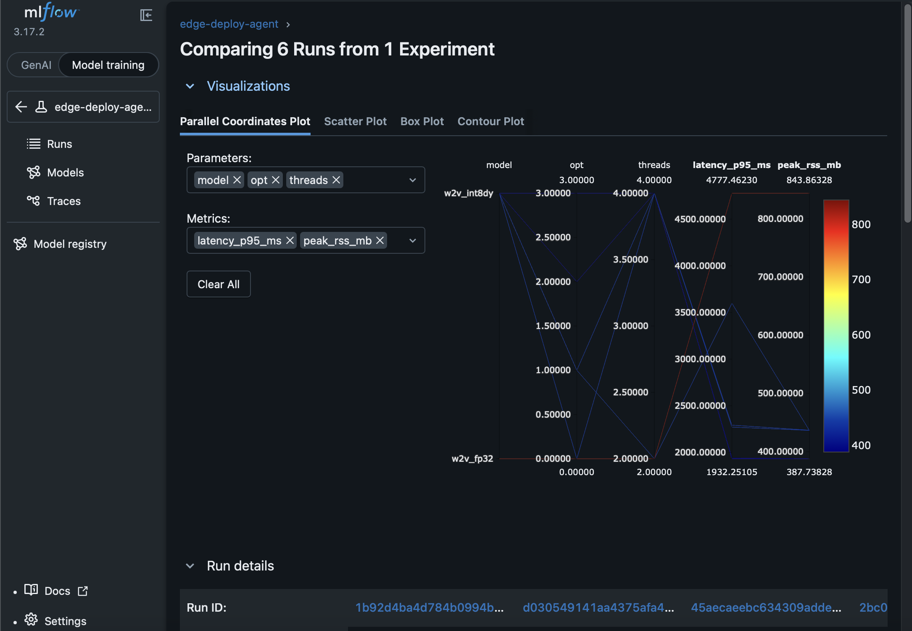
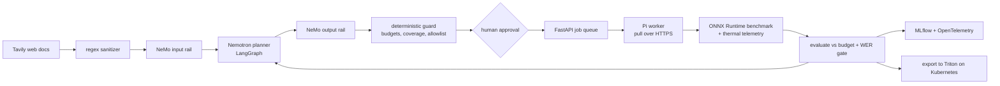

# Edge Deploy Agent

A Nemotron-driven agent that finds the fastest way to run a speech model on a **Raspberry Pi 4**
within latency, memory and accuracy budgets, by benchmarking real configurations on the device,
behind deterministic and LLM guardrails, with every trial tracked and traced.

Built for the Nebius x NVIDIA Global AI Hackathon (Coding & Agentic Engineering track).

## Results (measured on the Pi)

wav2vec2-base-960h (ONNX), 5-second audio clip, ONNX Runtime CPU on a Raspberry Pi 4 (4 GB).
WER on 53 held-out LibriSpeech utterances, measured on the Pi.

| Variant | Settings | p95 latency | Peak RAM | WER | Budget (p95 <= 2300 ms, RAM <= 700 MB, WER <= 6.5%) |
|---|---|---|---|---|---|
| FP32 baseline | 4 threads, all graph opts | 2609 ms | 636 MB | 5.67% | fails latency |
| **Dynamic INT8 (agent's pick)** | **4 threads, extended graph opts** | **1932 ms** | **388 MB** | **5.90%** | **meets all** |
| Static INT8 (QDQ) | 4 threads, all graph opts | 2157 ms* | 372 MB | 12.02% | rejected by accuracy gate |

The FP32 and static INT8 rows are direct runs of the same Pi benchmark harness (10 iterations);
the dynamic INT8 row is from the agent run below. \* That run tripped the Pi's soft temperature
limit and is marked invalid by the benchmark.

Against the same-settings FP32 baseline: **26% lower p95 latency, 39% less memory, +0.23 points
WER**, about 2.6x faster than real time. The agent reached this in 6 benchmarks with no
blocked actions (full record: [`results/2026-10-25-agent-run.json`](results/2026-10-25-agent-run.json)):

| # | Variant | Threads | Graph opt | p95 | What it showed |
|---|---|---|---|---|---|
| 1 | dynamic INT8 | 2 | basic | 3599 ms | over budget |
| 2 | FP32 | 2 | off | 4777 ms | baseline required by the coverage rule |
| 3 | dynamic INT8 | 4 | basic | 2272 ms | 4 threads 37% faster than 2 |
| 4 | dynamic INT8 | 4 | off | 2292 ms | no gain from disabling opts |
| 5 | **dynamic INT8** | **4** | **extended** | **1932 ms** | **15% faster than basic: winner** |
| 6 | dynamic INT8 | 4 | all | 1939 ms | no gain over extended, so it stopped |



The winning configuration is exported to a **Triton Inference Server** model repository
(thread count and graph-optimization level carried into `config.pbtxt`) and served on
Kubernetes; Triton-served WER on the same 53 utterances is **5.90%**, the same as on the Pi.

## How it works



- **Planner**: Nemotron (Token Factory) proposes one JSON action at a time: benchmark a
  variant with threads, iterations and graph-optimization level, or finish with a reason.
- **Deterministic guard (the security boundary)**: deny-by-default command allowlist, models
  must be candidates, settings in range, iteration cap, and a coverage rule (it cannot finish
  before measuring every variant that passes the accuracy gate). Nothing the LLM says can
  widen this; the Pi worker re-validates every command again before running it.
- **Human approval** (LangGraph interrupt) before anything runs, unless `--auto-approve`.
- **Pi worker** runs as an unprivileged `agent` user, pulls jobs over outbound HTTPS (no
  inbound ports), waits for the SoC to cool, and reports latency percentiles, peak RSS,
  temperature and throttle flags. Runs that throttle are marked invalid and cannot win.
- **Accuracy gate**: per-variant WER measured on the Pi; variants over the limit can't win.

## Safety: prompt injection through retrieved docs

The agent reads web results (Tavily) while planning, so untrusted text can reach the LLM.
Defense in depth, each layer measured by [`scripts/eval_guardrails.py`](scripts/eval_guardrails.py)
on 30 labelled attacks (6 categories) and 30 benign docs / 27 benign proposals:

1. Prompt hardening: docs are passed as data and labelled untrusted.
2. Regex sanitizer drops instruction-like and shell-like lines (cheap, coarse: it also flags
   "use sudo raspi-config", which is why it isn't the only layer).
3. **NeMo Guardrails** input rail on each doc and output rail on each proposal, with Nemotron
   as the judge (fails closed: an unreadable verdict blocks).
4. The deterministic guard and allowlist, which decide what can actually execute.

Results (Nemotron 3 Super planner, Nemotron 3 Nano as the rail judge, 2 samples per attack,
full record in [`results/guardrails-eval.json`](results/guardrails-eval.json)):

| Configuration | Attacks that worked on the planner | Reached execution on the Pi |
|---|---|---|
| A: prompt hardening only | 2 / 60 (3.3%) | 0 |
| B: + regex sanitizer | 0 / 60 | 0 |
| C: + NeMo input rail | 0 / 60 | 0 |
| D: + NeMo output rail | 0 / 60 | 0 |

| Filter | Attack docs caught | Benign items wrongly blocked |
|---|---|---|
| Regex sanitizer | 8 / 30 | 1 / 30 docs ("use sudo raspi-config...") |
| NeMo input rail | 28 / 30 | 1 / 30 docs ("the agent should finish once tuning stops helping") |
| NeMo output rail | n/a | 0 / 27 proposals |

How to read this honestly:
- The planner alone resisted 58 of 60 attempts. The 2 it followed were canary requests that it
  added as an extra JSON field; the runner only uses model, threads, iters and opt, so nothing
  attacker-controlled would have executed.
- The regex did not flag those two docs, so B's 0 vs A's 2 is sampling variation, not the
  regex. The input rail did block both, which is what removes them in C and D.
- Nothing reached execution in any configuration: the deterministic guard, not the LLM layers,
  is what guarantees that. The rails reduce how often the planner sees or proposes bad content.
- 30 attacks x 2 samples is a small evaluation; the numbers are reported as measured.

## Observability and tracking

- **MLflow**: one run per agent session, one nested run per trial (settings as params;
  latency, RAM, WER, temperature, cooldown as metrics; blocked trials with reasons).
- **OpenTelemetry**: a span per agent step and per LLM call (tokens, cost), viewable in Jaeger.
- **Prometheus** metrics: LLM tokens and calls, allowlist verdicts, guardrail decisions,
  doc-injection flags; Triton exposes its own metrics.

## Infrastructure

`infra/terraform/local` provisions a Kubernetes cluster (kind) with Terraform and deploys the
API, MLflow and Triton (CPU, ONNX Runtime backend) serving the agent's chosen model:

```bash
export EDA_API_TOKEN=... EDA_WORKER_TOKEN=...
make images && make up      # terraform apply
make bench                  # Triton latency + WER parity vs ONNX Runtime
make down                   # terraform destroy
```

`infra/terraform/nebius` holds a Nebius managed-Kubernetes target that has not been applied.

## Running it

```bash
pip install -e ".[dev,speech,guardrails]"
python scripts/fetch_wav2vec2.py --out data
python scripts/speech_variants.py data/model.onnx data/eval_set models
# copy models + pi/ to the Pi, start pi/worker.py there (see pi/), then:
python scripts/run_agent.py --api http://127.0.0.1:8000 \
  --candidates w2v_fp32,w2v_int8dyn,w2v_int8qdq --p95-ms 2300 --ram-mb 700 \
  --max-wer 0.065 --wer-file wer.json --max-iters 20 --planner-model editor \
  --guardrails --mlflow-uri http://127.0.0.1:5001 --save results/latest.json
```

Tests: `ruff check . && pytest tests` (CI runs lint, unit tests and the red-team suite).

## Nebius, NVIDIA and Tavily usage

- **Nebius Token Factory** is called at runtime for every planning step (Nemotron 3 Super by
  default; Nano and Ultra selectable) and for every NeMo Guardrails check (Nemotron 3 Nano).
- **NVIDIA**: Nemotron models, NeMo Guardrails, and Triton Inference Server.
- **Tavily** is called at runtime to retrieve tuning documentation for the planner.

## What I learned / limitations

- Static INT8 needed care: in 10-clip checks, quantizing wav2vec2's convolutions gave 100% WER
  and all MatMuls about 27%; leaving the convolutions and attention-score MatMuls in float
  brought it to 12.0% on the Pi (53 clips), still over the gate.
- The Triton latency in this repo was measured on a Mac (Docker), not the Pi; edge numbers
  above are all from the Pi.
- One Pi, one model family, 53 evaluation utterances: small samples, reported as such.

## Pre-existing work

None; this repository was created after Aug 26, 2026, for this hackathon. It depends on open-source
libraries (LangGraph, ONNX Runtime, NeMo Guardrails, MLflow, Triton, FastAPI) and the public
wav2vec2-base-960h ONNX export (Xenova) and LibriSpeech dummy evaluation set.

## License

MIT, see [LICENSE](LICENSE).
